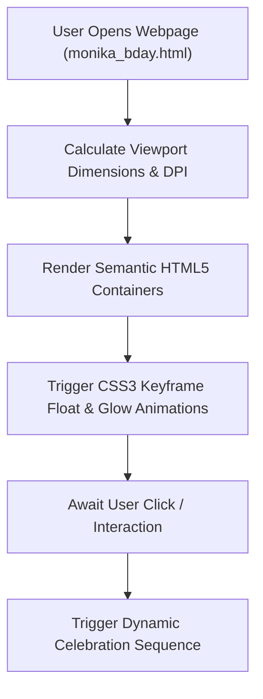

# 🎂 Celebration Web Experience — Responsive Interactive Greeting Engine

<p align="center">
  
</p>

<p align="center">
  <b>Modern Frontend Web Experience: Hardware-Accelerated CSS3 Keyframe Animations, Mobile-First Viewport Scaling, and Interactive DOM Effects.</b>
</p>

<p align="center">
  
  
  
  
</p>

<p align="center">
  
</p>

---

<a id="table-of-contents"></a>
## 📌 Table of Contents

- [📖 Executive Summary & Overview](#executive-summary--overview)
- [🎯 Key Features & Capabilities](#features)
- [🏗️ System Architecture & Pipeline](#system-architecture--pipeline)
- [🛠️ Tech Stack Breakdown](#tech-stack-breakdown)
- [⚙️ Reproducible Quickstart & Setup](#setup)
- [📁 Project Directory Layout](#project-layout)
- [🔮 Future Improvements & Roadmap](#future-improvements--roadmap)
- [🤝 Contributing Guidelines](#contributing-guidelines)
- [👨‍💻 Author & Contributions](#author--contributions)

---

<a id="executive-summary--overview"></a>
## 📖 Executive Summary & Overview

Creating engaging digital greeting experiences requires blending creative UI aesthetics with performant frontend engineering. Subtle CSS keyframe animations, responsive typography, and lightweight DOM interactions combine to produce an interactive experience without external library bloat.

The **Celebration Web Experience** (`monika-birthday-`) is a tailored, responsive celebratory web application built in pure **HTML5, modern CSS3, and JavaScript** by **Amaraiah C**. The application features fluid balloon/confetti animations, personalized typography, interactive celebratory elements, and mobile-friendly viewport scaling.

---

<a id="key-features--capabilities"></a>
## 🎯 Key Features & Capabilities

### ✨ 1. Fluid CSS3 Animations
- Keyframe animations (`@keyframes`) for smooth floating balloon movements and glowing particle effects.

### 📱 2. Mobile-First Responsiveness
- Fluid viewport scaling ensuring layout fidelity across mobile devices, tablets, and desktops.

---

<a id="system-architecture--pipeline"></a>
## 🏗️ System Architecture & Pipeline



---

<a id="tech-stack-breakdown"></a>
## 🛠️ Tech Stack Breakdown

| Technology | Usage | Details |
| :--- | :--- | :--- |
| **HTML5** | Semantic Content | Structured containers, interactive buttons, heading hierarchies |
| **CSS3** | Aesthetics & Animations | `@keyframes`, transitions, flexbox centering, gradient overlays |
| **JavaScript (ES6)** | DOM Manipulation | Click event bindings, dynamic element styling |

---

<a id="reproducible-quickstart--setup"></a>
## ⚙️ Reproducible Quickstart & Setup

### Prerequisites
- Modern web browser

```bash
# 1. Clone repository
git clone https://github.com/Amaraiah11/monika-birthday-.git
cd monika-birthday-

# 2. Launch web application in browser
start monika_bday.html
```

---

<a id="project-directory-layout"></a>
## 📁 Project Directory Layout

```text
monika-birthday-/
├── monika_bday.html           # Main responsive celebratory web application
└── README.md                  # Comprehensive project documentation
```

---

<a id="future-improvements--roadmap"></a>
## 🔮 Future Improvements & Roadmap

- [ ] Add sound effects using the HTML5 Web Audio API.
- [ ] Add interactive custom greeting card export (HTML-to-Canvas download).

---

<a id="author--contributions"></a>
## 👨‍💻 Author & Contributions

This project is developed and maintained with rigorous engineering standards by **Amaraiah C**, Software Developer and Applied Data Analytics Practitioner studying Bachelor of Computer Applications (BCA) at Alliance University, Bangalore.

- 🌐 **GitHub Profile:** [@Amaraiah11](https://github.com/Amaraiah11)
- 💼 **LinkedIn Profile:** [Connect on LinkedIn](https://www.linkedin.com/in/amaraiah-c/)
- 📧 **Institutional Email:** `camaraiahBCA24@ced.alliance.edu.in`

### 🤝 Contributing Guidelines
Contributions, bug reports, and architectural discussions are welcome!
1. **Fork** the repository: `https://github.com/Amaraiah11/monika-birthday-`
2. **Create a Feature Branch:**
   ```bash
   git checkout -b feature/your-feature-name
   ```
3. **Commit Your Enhancements:**
   ```bash
   git commit -m "feat: enhance feature logic"
   ```
4. **Push to Your Branch:**
   ```bash
   git push origin feature/your-feature-name
   ```
5. **Open a Pull Request** against the `Amaraiah-C` branch.

---

<p align="center">
  <b>⭐ If this codebase or documentation assisted your engineering workflows, please star the repository! ⭐</b>
</p>

<p align="center">
  
</p>
